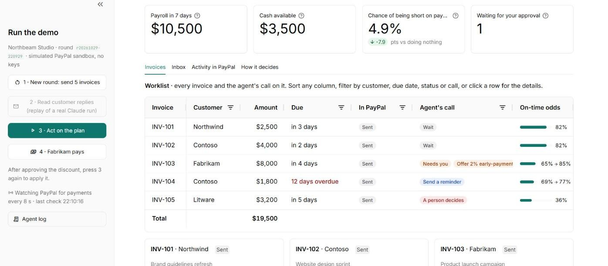

# Receivables Copilot

**A collections agent for PayPal invoices that decides who to chase, how, and when to ask you first.** Built for the PayPal AI Hackathon.

Freelancers and small studios get paid through PayPal invoices, and payroll does not wait for late customers. PayPal's automatic reminders treat every customer the same. Receivables Copilot looks at each open invoice, works out the chance that the money arrives before payday, and picks one action per invoice:
- **wait**;
- **send a reminder**;
- **offer an early-payment discount**;
- **hand it to a person**.

It does all of it through the PayPal Invoicing API, with Claude reading customer replies and writing reminders.



## Try it in 2 minutes, no keys needed

```bash
pip install -r requirements.txt
python -m streamlit run panel.py
```

Without a `.env`, the app runs in **demo mode**: a built-in simulator (`simulador_paypal.py`) answers the same PayPal Invoicing v2 calls, behind the same wrapper, and Claude's step **replays a real Claude run** (`grabacion_claude.json`): the same tool calls, checked again by code. With sandbox keys in `.env`, the same buttons create, remind and update real invoices in the PayPal sandbox and Claude reads live.

Press the sidebar buttons in order:

| Step | What you should see |
|---|---|
| Start | Payroll $10,500 in 7 days, $3,500 in cash. Chance of being short: **4.9%** with the plan (10.4% doing nothing) |
| **2 · Read customer replies** | Litware's dispute and Contoso's confirmation are recorded with their exact quotes; the fake "Fabrikam finance" email is ignored. Claude writes the reminder for the overdue invoice. Doing nothing would now leave a 12.8% risk; the new plan keeps it at 4.9% |
| **3 · Act on the plan** | The reminder goes out; Litware goes to a person; the $160 discount for Fabrikam waits for you |
| **Approve**, then **3** again | The 2% discount is added to Fabrikam's invoice |
| **4 · Fabrikam pays** | $7,840 is paid on the invoice in PayPal. Nothing tells the agent: it reads PayPal (on every screen refresh and every 8 seconds), spots the payment and re-plans. Short-risk 4.9% → **0%**; the only change is that the overdue reminder is no longer needed |

Then open the **Dashboard (AG Studio)** tab: the same numbers, live, with Fabrikam paid up and payroll 108% covered. Click a customer to filter the page.

**Proof it ran on the real sandbox:** [`evidencia/recibo_r20261028-132115.md`](evidencia/recibo_r20261028-132115.md) lists every action of a real demo round with its PayPal invoice id, re-queried from PayPal (discount on the invoice, payment found, MARKED_AS_PAID).

## The demo

Northbeam Studio (fictional) has $3,500 in cash and a $10,500 payroll in 7 days. Five invoices are open with four customers. Each customer's payment history is 8-20 earlier invoices, already paid, in the same PayPal account.

1. **Before reading replies,** doing nothing leaves a 10.4% chance of missing payroll. The plan brings it to 4.9%.
2. **Customer replies arrive.**
   - Litware disputes its invoice, so it goes to a person.
   - Contoso confirms it will pay on Friday, so the agent stops chasing that invoice.
   - A fake "Fabrikam finance" email from a look-alike domain asks to mark an invoice as paid and stop the reminders. It is ignored: it is not from Fabrikam's domain, and no tool can mark invoices paid.
3. **The plan changes.**
   - A 2% early-payment discount for Fabrikam's $8,000 invoice. That is $160, above the $150 the agent may give on its own, so **it asks the owner first**.
   - A reminder for Contoso's overdue invoice.
   - Without reading the replies, the agent would have offered a discount to the customer who was disputing.
4. **The owner approves.** The discount is added to the invoice in PayPal.
5. **Fabrikam pays $7,840 in PayPal.** The screen reads every invoice from PayPal every 8 seconds; when the amount paid on one goes up, however it got there, the agent re-plans on its own. Cash covers payroll, and the only decision that changes is that the overdue reminder is no longer needed.

## How it decides

For every combination of actions on the open invoices, it simulates 5,000 scenarios of when each customer pays. It then takes the cheapest combination that keeps the chance of being short on payday under 5%. The cost counts:
- discounts given;
- a small goodwill cost per reminder;
- $1,500 for a missed payroll, weighted by its probability.

If no combination is safe, it takes the cheapest one counting the risk, and says that a person should look at other cash.

The screen draws those scenarios: cash for each day until payroll, the band that holds 90% of them with the plan and if the agent does nothing, against the $0 line. The plan mostly lifts the bad case; the median can be a little lower, because a discount gives away 2% of an invoice.

Rules live in code (`triage_core/collections_decision.py`):
- discounts above $150 need the owner;
- reminders go out at most every 5 days, from 3 days before the due date;
- a customer who confirmed a payment date is not chased;
- **payment plans are built but off by default.** Turned on, a customer who asks for more time is not reminded and gets no discount: the agent offers half within 3 days and the rest 30 days later, the owner approves, and the PayPal invoice accepts partial payments with that minimum (`configuration.partial_payment`, checked on the real sandbox). We tested it before switching it on: in 1,000 simulated weeks (two fresh seeds, hypotheses written first) half the money arrived after payday, the agent collected $300-$470 a week less from those customers and was no safer on payday. So it stays off, as an option for owners who put the relationship first;
- disputed invoices, or invoices more than 45 days late, always go to a person.

Customers' on-time odds come from their payment history, which the agent **reads from PayPal**: the due date and the payment date of every earlier paid invoice (`historial_paypal.py`). The odds are shrunk towards the portfolio average by empirical Bayes.

**It checks itself** (`triage_core/collections_calibration.py`). For every invoice it keeps what it believed, what it did and whether the customer then paid on time. From that record a small logistic regression corrects:
- its own forecast;
- how much being overdue lowers the odds;
- how much a reminder and a discount really lift them;
- how far to trust each kind of reply, a dispute included.

Each invoice a customer pays on their own (no reminder, no discount, not disputed, not already overdue) joins that customer's history five weeks later, once even late payments have arrived. So it also learns customer by customer.

It also checks each week: the chance of being short it predicted for the plan it chose, against whether it really was short. Small errors on many invoices add up in the tail, so it corrects that risk too before comparing plans (`fit_risk`).

It starts from the policy's assumptions and moves only as far as the evidence pushes it. The demo studio is new and has no track record yet, so the demo runs on the policy's assumptions.

## What the model does and what the code does

| Claude (through typed tools) | Code |
|---|---|
| Reads customer replies and records what they mean (dispute, confirmation, asking for time) with the exact quote | Which invoices to chase, discounts, limits, approvals, duplicate protection |
| Writes the reminder text and explains the plan | The effect of each signal on the odds (fixed in policy) |

A reply only counts if all of these hold:
- it comes from that customer's own domain;
- the signal is one of the allowed kinds;
- the quoted sentence appears word for word in the email.

An approval is bound to the exact discount, the customer, the invoice and the evidence the owner saw. If the evidence changes, the agent asks again.

Every action goes to a ledger with its `PayPal-Request-Id`, and every change is also appended to an audit trail where each event carries the hash of the one before. `python verificar_auditoria.py` checks the chain and the ledger against it.

## The worklist (AG Grid)

The **Invoices** tab opens with a worklist built on [AG Grid Community](https://www.ag-grid.com/) 36.2, inside our own Streamlit component (`tabla_aggrid.py`, Components v2):
- one row per invoice: amount, due date, its status in PayPal (with what has been paid), the agent's call and the on-time odds before → after acting, drawn by custom cell renderers;
- hover the agent's call to read its reason; click a row to open the invoice and approve or reject the discount there;
- sort any column and filter by customer, due date, status or the agent's call; when a payment lands in PayPal the row updates in place and the changed cells flash.

The **How it decides** tab adds a second grid: the payment history the forecast learns from (every earlier paid invoice, read from PayPal), with a quick filter across all columns.

AG Grid loads from jsDelivr at a pinned version. Without internet the grids say so; the invoice cards below them still show every decision, with its approval buttons.

## The dashboard (AG Studio)

The **Dashboard (AG Studio)** tab is a report built with [AG Studio](https://www.ag-grid.com/studio/) 3.0, AG Grid's embedded analytics, inside our own Streamlit component (`estudio_ag.py`). It opens ready-made, in view mode: the saved report lives in code (`estudio_datos.INFORME`). Its data is the same as the rest of the screen, read from PayPal on every refresh, so when a payment lands the dashboard updates in place.

- **Who still owes what**, a custom widget: a friendly scoreboard, biggest balance first, with a bar of what each customer has already paid. Click a customer and the whole page filters to them.
- **Payroll covered**, a second custom widget: cash available against payroll. When Fabrikam pays, it goes from 33% to 108%.
- AG Studio's own widgets for the rest: totals, the agent's call on each invoice (a grid), on-time odds with the agent's call vs without it, days late and on-time history by customer, and the cash on a bad day until payroll. Click a bar to cross-filter the page.
- Themed like the app (its teal, Inter, the same borders and corners), with amounts in US dollars whatever the browser's language.
- **Edit dashboard** (**Edit or ask Claude** when the assistant is on) opens AG Studio's editor: drag, resize, add or change widgets. **Reset to the saved dashboard** brings the saved report back.

**Ask Claude for a view.** With a Claude key, the editor shows AG Studio's AI assistant. It runs AG Studio's agent framework with its five built-in agents plus one of ours, the **Collections analyst**: it knows the business, reads the collections plan through a read-only tool (`read_collections_plan`) and hands the building to the built-in agents. Every model turn goes from the browser to the Python server through the Streamlit component, and the server asks Claude (`agente_estudio.py`), so the key never reaches the browser. Claude only returns text and tool calls; AG Studio runs them in the browser, and they only change the dashboard. No tool there can change an invoice, send a reminder or move money.

In our tests, "Show who still owes us money, biggest first" got the four balances right and pointed to the scoreboard, and "Add a donut chart of how much is still owed, split by the agent's call" added that chart. Each request took several Claude turns, under a minute. In demo mode (no Claude key) the assistant is not shown; everything else in the tab works.

Limits, since every turn costs money: the assistant appears only with the Claude key in this machine's `.env` (or with `RC_STUDIO_ASSISTANT=1`), so a public deployment that keeps the key in its secrets for step 2 does not open it to every visitor by accident. Each session gets 60 turns and the whole server 150 a day, and one request is capped in size. Claude answers in a background thread, so the screen never waits for it and a turn asked for twice is paid once. Pressing a sidebar step while Claude is still answering redraws the dashboard in view mode, and that chat starts over.

AG Studio is commercial software: without a license key it logs a license notice in the browser console and may show a watermark. Put a trial key in `.env` as `AG_STUDIO_LICENSE=...`. It loads from jsDelivr at a pinned version (about 1.7 MB the first time, only when the tab is opened); offline, the tab says so and the rest of the screen works.

## Traps it handles (each one is an automated test)

| Trap | What happens | Test |
|---|---|---|
| A look-alike "Fabrikam finance" email asks to mark an invoice paid and stop reminders | Ignored: wrong domain, and no tool can mark paid or stop reminders | `test_the_fake_fabrikam_email_cannot_mark_anything_or_count`, `test_no_tool_can_mark_paid_or_stop_reminders` |
| A customer disputes an invoice | No reminder, no discount: a person decides | `test_after_the_replies_a_dispute_goes_to_a_person_and_a_promise_is_respected` |
| A customer already promised a date | It stops chasing that invoice | `test_copilot_reading_replies_never_presses_a_dispute_or_a_promise` |
| A customer asks for more time (with payment plans turned on) | No reminder, no discount: a payment plan the owner approves, and the PayPal invoice accepts partial payments | `test_a_customer_who_asks_for_time_gets_a_payment_plan_in_paypal` |
| A reply that names one invoice | Only that invoice is marked as disputed or promised; the customer's other invoices are still chased as usual (their odds do improve) | `test_each_reply_only_touches_the_invoices_it_names` |
| Claude writes a reminder with a link, bank details or a discount | Rejected by code (anti-phishing) | `test_reminders_cannot_promise_discounts_links_or_other_payment_routes` |
| Claude drafts a reminder the plan did not ask for | Rejected by code | `test_a_reminder_needs_the_plan_and_only_for_invoices_it_says_to_remind` |
| A discount above the owner's limit | Waits for the owner, then goes out once | `test_the_big_discount_waits_for_the_owner_and_then_goes_out_once` |
| The owner says no | Never offered in that round | `test_a_rejected_discount_is_never_offered` |
| The evidence changes after an approval | A new approval is needed | `test_new_evidence_needs_a_new_approval` |
| PayPal fails while sending a reminder | Retried with the same `PayPal-Request-Id`: never two emails | `test_a_failed_reminder_is_retried_with_the_same_request_id` |
| A payment is recorded twice | Recorded once; the plan relaxes | `test_a_payment_is_recorded_once_and_the_plan_relaxes` |
| Someone edits, deletes or adds a ledger entry, or edits its audit trail | The hash chain or the ledger check fails, and the agent touches no invoice until a person looks | `test_the_audit_trail_catches_an_edited_event_and_a_ledger_changed_by_hand` (shared engine) |

## Evidence: 1,000 simulated weeks

Seven agents faced the same synthetic weeks with the same luck:
- Receivables Copilot;
- the same agent without reading replies;
- the same agent without any learning;
- the same agent with each customer's history fixed;
- PayPal-style fixed reminders;
- a discount for everyone;
- doing nothing.

Reminders and discounts work a bit *less* well in the simulation than the agent assumes, so it does not play on home turf. Hypotheses were written in the code before running each pair of fresh seeds (`simulacion.py`).

Results on the latest fresh seeds (2040 and 2041):
- **A third of the reminders:** 1.3 a week against 3.4.
- **It never chased a customer who disputed an invoice or had already confirmed payment.** The fixed schedule chased a disputing customer in about a quarter of the weeks, and one who had confirmed in almost half.
- **It knows how much risk it runs:** its weekly forecast was within 1 point of what happened on both seeds (−0.5 and +0.7). Without learning, it expected 5-10 points less risk than it ran.
- **Fewer weeks short on payday than fixed reminders:** 1.3 points fewer (clear) and 0.4 fewer (within noise). Across the eight fresh seeds we have run since the first version, it was short less often every time, clearly in seven.

**How much is there to gain?** We built an agent that knows the truth: each customer's real odds, the real effect of a reminder and a discount, and how replies relate to what customers do. With the same decision rule, it would save $8-$11 a week against fixed reminders on these seeds (within noise) and $23 on an earlier one. Most weeks short of cash cannot be saved by any reminder or discount.

**Honest misses:**
- It is *not* cheaper than fixed reminders: $3.50 a week cheaper on both seeds, which is within noise. Even the agent that knows the truth is only $8-$23 cheaper.
- Learning each customer's history helped on one seed and not on the other (it knew its customers better on the first, and was $13.50 a week cheaper than with a fixed history on the second).
- Learning from disputes fixed the forecast for disputed invoices, but not the decisions.
- We found a bug in our own simulator: customer replies were drawn separately from what customers then did, so they predicted nothing. Earlier results had it; these do not.

Full write-up, including earlier versions and what failed: `RESULTADOS_SIMULACION.md` (Spanish).

## What is real and what is simulated

- **Real PayPal sandbox API calls (Invoicing v2):**
  - create, send and remind;
  - full update to add the discount;
  - cancel;
  - record payment.
- Every write carries a `PayPal-Request-Id`, so a retry never sends a second email or records a second payment.
- **Read back from PayPal:** each customer's payment history (52 paid invoices, listed and read through Invoicing v2).
- **Simulated:** the customer paying, which is recorded as an external payment on the invoice. Also synthetic: the studio, the replies, and the history itself. We loaded the history into the sandbox once as paid invoices (sent without emailing anyone, each payment recorded on its real date), and the agent reads it back the way it would read a real account.
- **Demo mode (no keys):** `simulador_paypal.py` plays the PayPal sandbox under the same wrapper, and Claude's step replays a recorded real run (recorded on the simulator, from the demo's starting invoices). Claude's briefing is shown as current only while the plan on screen is the one Claude saw; once it changes (say, a customer pays), the screen says the briefing is out of date and keeps it folded away. `RC_GRABAR=1` with a Claude key records a new run. The screen says so in a banner. It keeps its own ledger (`data_simulada/`), apart from the real sandbox's.

## Run it

```bash
pip install -r requirements.txt
# .env (never committed): PAYPAL_CLIENT_ID, PAYPAL_CLIENT_SECRET, PAYPAL_ENVIRONMENT=SANDBOX, ANTHROPIC_API_KEY
# optional: AG_STUDIO_LICENSE (an AG Studio license or trial key);
#           RC_STUDIO_ASSISTANT=1 to offer the dashboard's Claude assistant when the key is not in .env
# without it, the app runs in demo mode (see "Try it in 2 minutes" above)
# once, with keys: load the customers' payment history into your sandbox (52 paid invoices, no emails)
python historial_paypal.py
python -m streamlit run panel.py
```

In the sidebar:
1. **New round**: creates and sends the 5 invoices in your PayPal sandbox.
2. **Read customer replies.**
3. **Act on the plan.**
4. Approve the discount, then **Act on the plan** again.
5. **Fabrikam pays.**

The same steps exist on the command line: `preparar_facturas.py`, `ejecutar_plan.py --correo`, `aprobar.py`, `ejecutar_plan.py --paga INV-103`.

Tests (offline, no keys): `python -m pytest tests motor_comun/tests` (the app and the shared engine, 93 tests). The engine lives in `motor_comun/`.

## Use of AI

- **In the product:** Claude (`claude-opus-5-5`) reads replies, writes reminders and explains the plan, as described above, and builds dashboard views through AG Studio's agents. It never sees API keys and cannot move money or mark invoices paid.
- **In development:** built with Claude Code as a coding assistant. The author designed the product, the decision rule and the evaluation, and reviewed and ran every step.

## Shared engine

The forecasting, approval, ledger and signal-checking engine (`triage_core/`) is also used by Treasury Triage, a separate product built for the Airwallex hackathon. That product decides what to pay; this one decides how to collect. The product, the decision and the PayPal integration are specific to this project.

## License

MIT.
